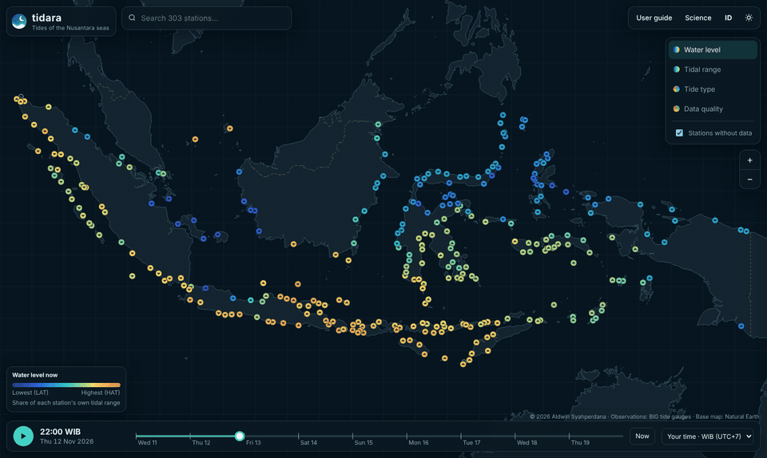
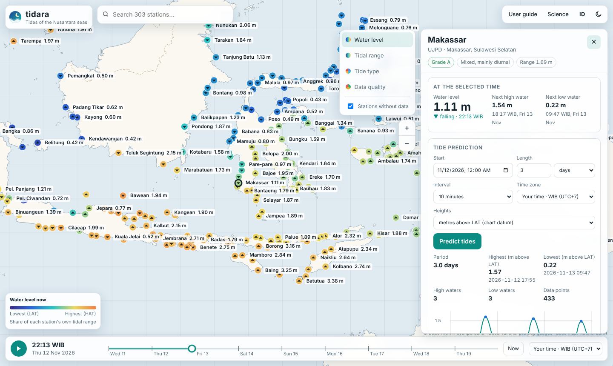
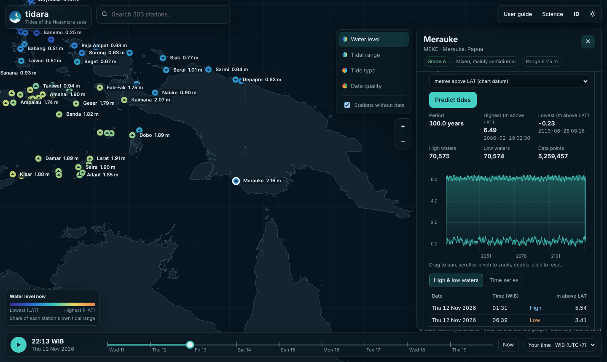
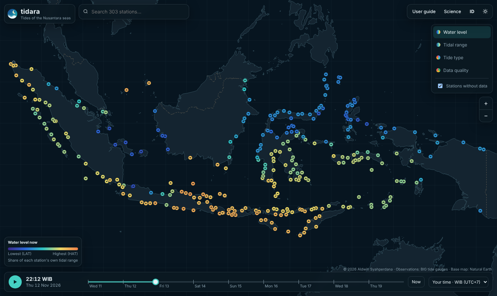
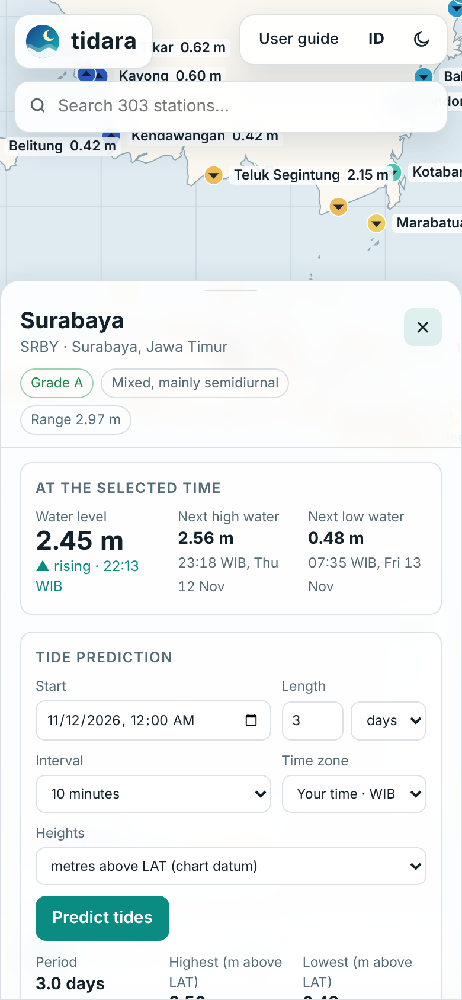
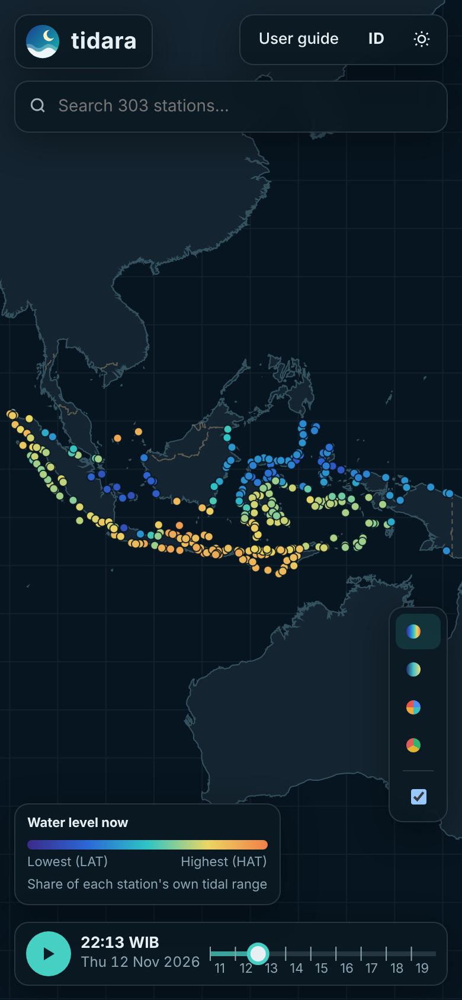

<div align="center">


# Tidara

**Tide predictions for the Indonesian seas**

Interactive map and tide prediction tool for 303 tide gauge stations across Indonesia, built on harmonic constants derived from 4.6 years of 1-minute sea-level observations.

[**Open the live site**](https://syahperdana.github.io/tidara/) · [User guide](https://syahperdana.github.io/tidara/guide.html) · [Science & methods](https://syahperdana.github.io/tidara/science.html)




</div>

---

## Overview

Tidara (from *tide* + *Nusantara*) shows what the tide is doing right now at every station in the Indonesian tide gauge network, and predicts it for any period, from a few hours to a hundred years. It runs entirely in the browser: no server, no map tiles, no frameworks. The whole site is about 200 KB to download.

The tidal constants behind it were derived independently from the raw observations of the national tide gauge network, quality-controlled station by station, and tested against data the analysis had never seen.

| | |
|---|---|
| **Stations with harmonic constants** | 303 |
| **Observation period** | October 2021 – May 2026 (1-minute data, ~100 GB raw) |
| **Median clean record per station** | 3.0 years |
| **Median skill on unseen data** | 97.9% of water-level variance explained |
| **Median prediction error (RMSE)** | 6.4 cm |
| **Agreement with BIG's published datums** | within 5 cm at 76% and within 10 cm at 89% of stations |

## Features

- 🗺️ **Interactive map**: 303 stations from Sabang to Merauke, with pan, zoom, pinch and search by name, code or province.
- 🌊 **Live water level**: each station is coloured by where the tide is within its own range, with rising/falling arrows.
- ⏯️ **Timeline**: drag or play the next seven days and watch high water sweep across the archipelago.
- 🧭 **Four map layers**: water level, tidal range (HAT − LAT), tide type (Formzahl) and data quality grade.
- 📈 **Predictions from hours to 100 years**: 1 to 60-minute intervals, up to 6 million values per run, computed in a background worker in a few seconds.
- 📋 **High and low water tables** to the minute, plus the full time series, page by page.
- 🔍 **Zoomable chart**: from a 100-year overview down to a single tide, on mouse or touch.
- 💾 **CSV export and copy** for Excel, GIS and engineering tools.
- 🕒 **Your own time zone** by default (daylight saving aware), with WIB, WITA, WIT and UTC one click away.
- 📐 **Chart datum or MSL**: heights above LAT or relative to mean sea level, with HAT, MHWS, MHWN, MSL, MLWN, MLWS and LAT for every station.
- 🌗 **Day and night mode**, following your device or switched by hand.
- 🇮🇩 **English and Bahasa Indonesia** across the whole site, including the guide, the science page and the CSV files (semicolon separators and decimal commas in Indonesian).
- 📱 **Mobile friendly**: bottom-sheet station panel and touch controls.
- 🔓 **Transparent**: every station shows its harmonic constants, record length and measured accuracy.

## Screenshots

| Day mode, station panel | Night mode, 100-year prediction |
|---|---|
|  |  |

| Night mode overview | Phone, Bahasa Indonesia | Phone, night mode |
|---|---|---|
|  |  |  |

## How it works

```
1-minute gauge records (pressure, float, radar sensors)
        │  reduce to hourly values (median of ±5 min), merge 14-day and 24-day files
        ▼
Quality control per station
        │  flat/stuck sensors, spikes, wrong tidal gain, sensor drift,
        │  datum steps after maintenance, low-water clipping
        ▼
Harmonic analysis (least squares, up to 48 constituents, nodal corrections)
        │  hold-out test on the last 10% of each record
        ▼
Station database (constants, datums, accuracy)  ──►  Tidara engine in the browser
```

Each prediction is the sum of the station's tidal constituents:

```
h(t) = Σ f·H·cos(V0(t) + u − g)
```

where *H* and *g* are the harmonic constants (amplitude and Greenwich phase lag), *V0* is the astronomical argument from the positions of the Moon and Sun (Schureman, 1958), and *f* and *u* are the 18.61-year nodal corrections. Because the astronomy is known, the same constants predict the tide for any date. Full details are on the [Science page](science.html).

## Project structure

```
tidara/
├── index.html            Map and prediction tool
├── guide.html            User guide (EN / ID)
├── science.html          Data, methods and validation (EN / ID)
├── assets/
│   ├── tidara-data.js    Station metadata, datums and harmonic constants
│   ├── tide-engine.js    Prediction engine (also runs in a Web Worker)
│   ├── basemap.js        Coastlines and borders (Natural Earth)
│   ├── prefs.js          Language and day/night preferences
│   ├── site.css          Styles for the guide and science pages
│   └── logo.svg          Logo
└── docs/screenshots/     Images for this README
```

## Run it locally

No build step and no installation. Either open `index.html` directly in a browser, or serve the folder:

```bash
# Python 3
python -m http.server 8000
# then open http://localhost:8000
```

## Deploy on GitHub Pages

1. Push this folder to a repository (for example `tidara`).
2. In the repository go to **Settings → Pages**.
3. Under **Build and deployment**, choose **Deploy from a branch**, branch **main**, folder **/ (root)**, and save.
4. After a minute the site is live at `https://YOUR-USERNAME.github.io/tidara/`.

## Updating the data

The analysis scripts produce `tidara-data.js`. To refresh the constants with new observations, rerun the analysis and replace `assets/tidara-data.js`; nothing else needs to change.

## Limitations

- Predictions are the **astronomical tide only**. Wind, air pressure, monsoon sea-level anomalies, river floods and waves can change the actual sea level by tens of centimetres.
- Mean sea level is the mean of each gauge's 2021–2026 record. It is not tied to a national vertical datum and does not include future sea-level rise or land subsidence.
- **Not for navigation.** Use official tide tables and nautical charts for navigation and safety-critical work.

## Data and credits

- Observations: tide gauge network of **Badan Informasi Geospasial (BIG)**, Indonesia.
- Base map: [Natural Earth](https://www.naturalearthdata.com/) 1:10m land and boundaries (public domain).
- Methods: Schureman (1958); Foreman (1977); Pawlowicz, Beardsley & Lentz (2002, T_TIDE); Pugh & Woodworth (2014).
- Font: [Plus Jakarta Sans](https://fonts.google.com/specimen/Plus+Jakarta+Sans) (SIL Open Font License).

---

<details>
<summary><b>🇮🇩 Ringkasan dalam Bahasa Indonesia</b></summary>

**Tidara** adalah peta interaktif dan alat prediksi pasang surut untuk 303 stasiun pasut di seluruh Indonesia. Konstanta harmoniknya diturunkan secara mandiri dari data pengamatan per menit selama 4,6 tahun (Oktober 2021 – Mei 2026), melalui kendali mutu per stasiun, lalu diuji pada data yang belum pernah dipakai dalam analisis: median akurasi 97,9% dan median galat 6,4 cm.

Fitur utama: peta muka air saat ini, lini waktu tujuh hari yang dapat diputar, empat lapisan peta, prediksi dari beberapa jam hingga 100 tahun, tabel air tinggi dan air rendah, grafik yang dapat diperbesar, ekspor CSV, zona waktu pengguna otomatis, mode siang dan malam, serta tampilan Bahasa Inggris dan Bahasa Indonesia. Situs ini berjalan sepenuhnya di peramban, tanpa server, dan ringan untuk ponsel.

Prediksi hanya mencakup pasut astronomis dan **tidak untuk navigasi**.

</details>

<div align="center">

© 2026 Aldwin Syahperdana. All rights reserved.

</div>
